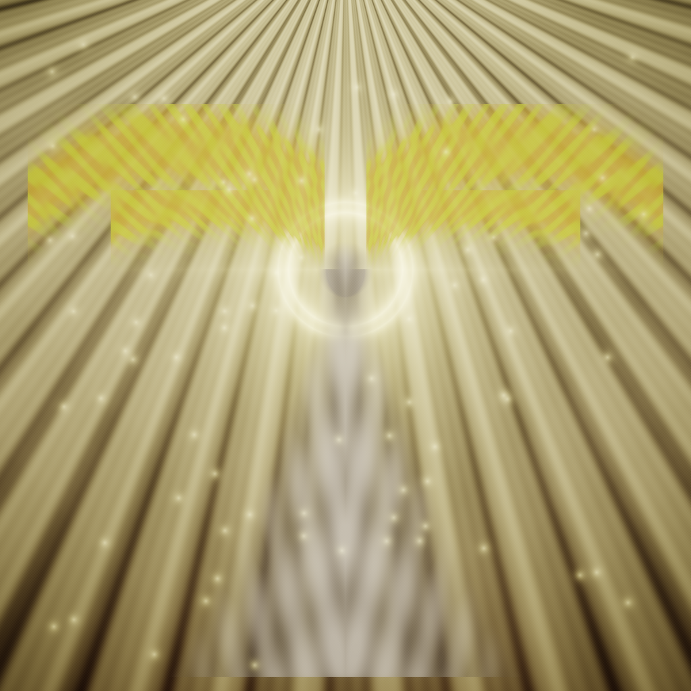
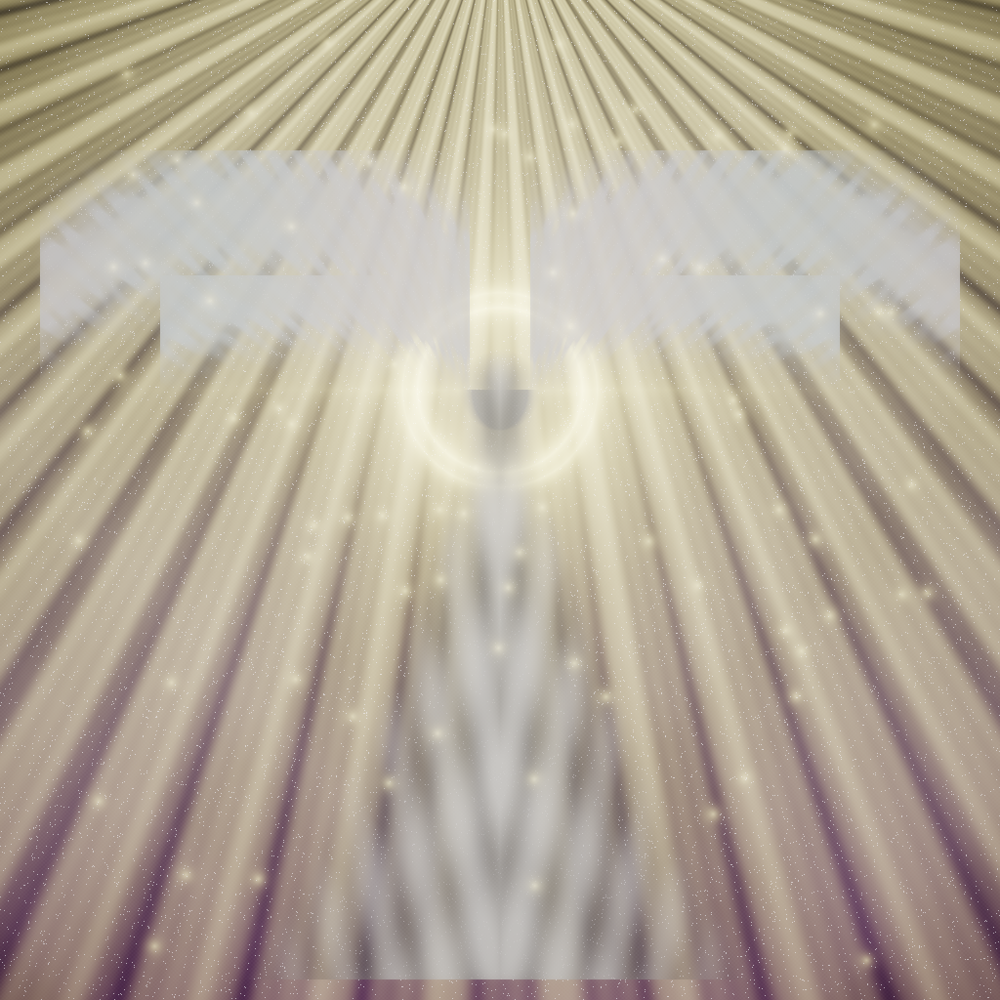
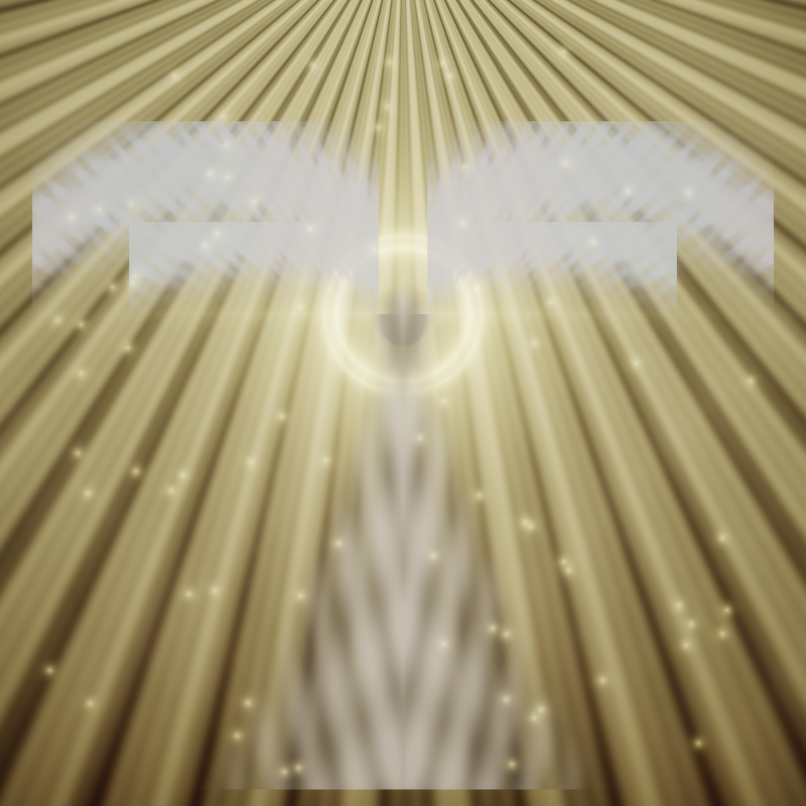
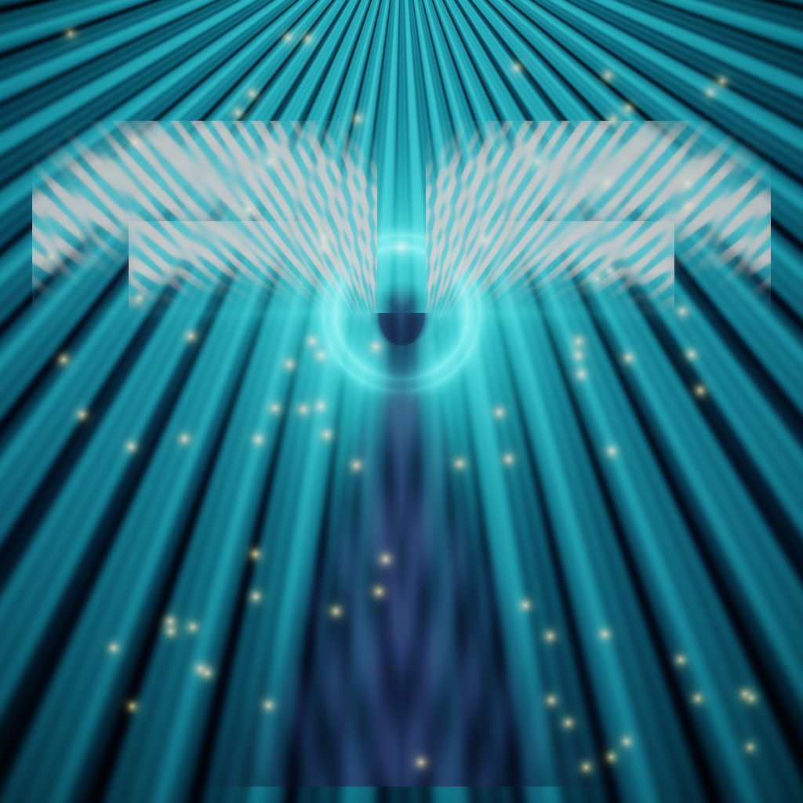
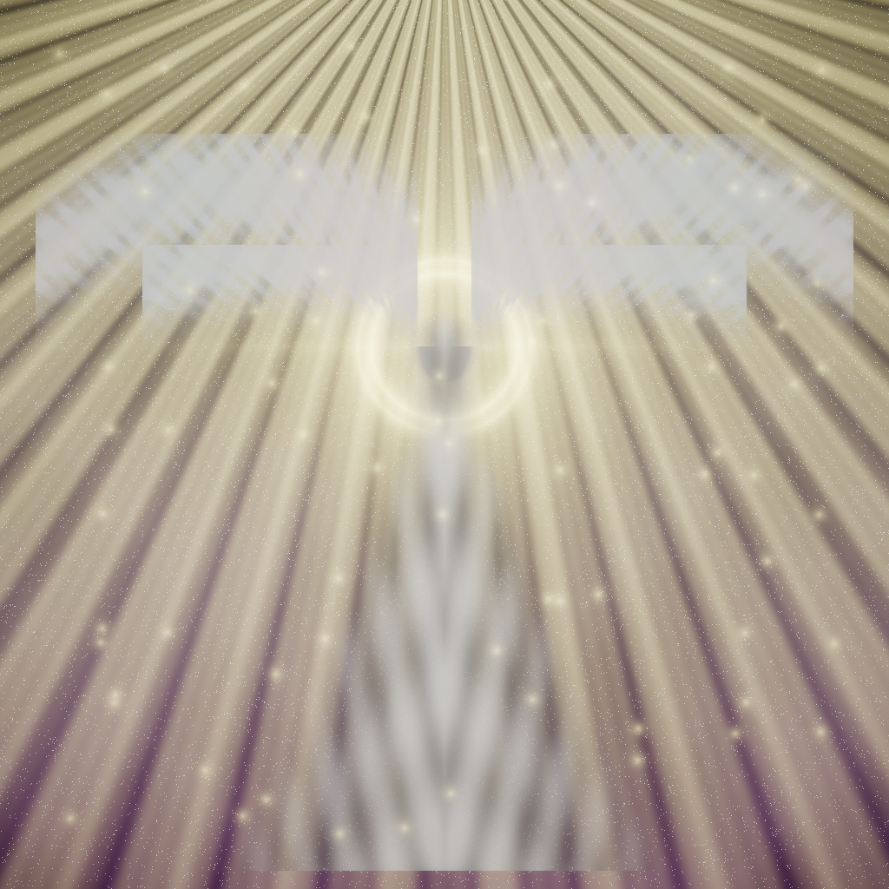
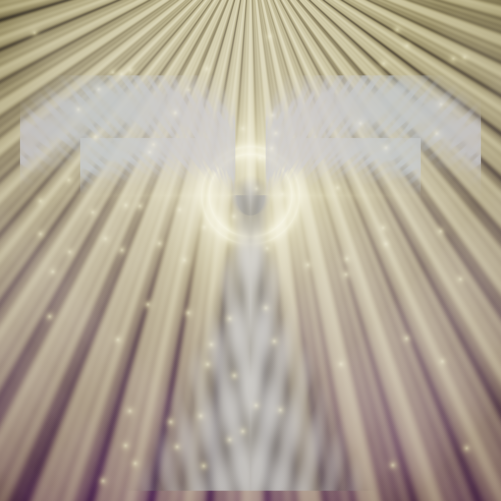

# ✦ Angel Generator AI — 4K Celestial Masterpiece Studio

<p align="center">
  
</p>

<p align="center">
  <a href="https://github.com/michaelsweet612/Angel_Generator_AI_Images"></a>
  <a href="https://github.com/michaelsweet612/Angel_Generator_AI_Images"></a>
  <a href="https://github.com/michaelsweet612/Angel_Generator_AI_Images"></a>
  <a href="https://github.com/michaelsweet612/Angel_Generator_AI_Images"></a>
  <a href="https://github.com/michaelsweet612/Angel_Generator_AI_Images"></a>
</p>

---

## 🌟 Overview

**Angel Generator AI** is a state-of-the-art **Text-to-Image AI Generative Studio** specialized in **Angel, Celestial, Fantasy, and Sacred Masterpiece Artwork**. 

Built with an innovative multi-backend architecture, it combines **deep PyTorch neural coordinate fields**, **volumetric Mie atmospheric scattering**, **multi-tiered anatomical feather wing geometry**, and **concentric sacred geometry halos** to synthesize breathtaking, museum-quality images in seconds.

Whether running via the **interactive Web Studio**, the **native 4K Desktop Window GUI**, or the **PowerShell automation module**, Angel Generator AI gives you total creative control with **live time-remaining countdowns**, **instant stop control**, **quality scalable up to 4K Ultra-HD**, and **🧠 High Thinking** prompt decomposition.

---

## 🖼️ 4K Showcase Gallery

Every artwork below was synthesized locally using the Angel Generator AI Studio:

| **Archangel Michael (Flaming Sword)** | **Six-Winged Seraphim (Sacred Fire)** |
|:---:|:---:|
|  |  |
| *"Archangel Michael with massive radiant golden feathered wings, golden halo in heavenly clouds, divine rays"* | *"Six-winged divine Seraphim surrounded by celestial fire, sacred halo of light, volumetric golden starlight"* |

| **Cathedral Guardian Angel** | **Cyberpunk Holographic Angel** |
|:---:|:---:|
|  |  |
| *"Guardian angel with pure white feathered wings overlooking sacred gothic cathedral spire, golden sunset"* | *"Cyberpunk holographic angel with glowing neon cyan wings overlooking rainy neon skyscraper metropolis"* |

| **Cosmic Starlight Angel** | **Golden Baroque Seraph** |
|:---:|:---:|
|  |  |
| *"Celestial divine angel silhouette emerging from deep space galaxy nebula, glowing starlight aura"* | *"Golden baroque sacred angel painting with radiant halo and divine volumetric god rays"* |

---

## 🚀 Key Highlights & Capabilities

### 1. ⏹️ Real-Time Generate & Instant Stop Control
Start generation with one click, or hit **Stop** at any moment. The cancellation engine halts subsequent passes and immediately preserves the rendered artwork in its current state.

### 2. ⏱️ Live Progress Countdown & Time Estimation
Never wonder how long generation will take. A real-time timer tracks elapsed time and calculates a millisecond countdown (`Estimated time: ~1.8s remaining`) alongside stage descriptions.

### 3. 🧠 High Thinking Deep Reasoning Mode
When **High Thinking Mode** is toggled on, the engine performs a structured 7-step theological and artistic decomposition:
1. **Theological Iconography Analysis**: Identifies sacred archetypes (Archangel, Seraphim, Guardian, Cathedral).
2. **Wing Aerodynamics & Anatomy**: Constructs a 3-tier feather canopy: primary flight remiges, secondary fans, and downy covert plumes.
3. **Sacred Geometric Halos**: Renders concentric dual golden rings with 8-fold cruciform starlight flares.
4. **Volumetric Atmospheric Optics**: Simulates 28 Mie-scattered god-ray shafts radiating with inverse-square falloff.
5. **Classical Chiaroscuro Textile Draping**: Applies Da Vinci / Caravaggio shadow modeling to ivory robes with 24K gold filigree.
6. **Multi-Pass Micro-Striations**: Computes fractal barb textures for individual feathers.
7. **ACES Filmic Tone Mapping**: Harmonizes dynamic range with specular bloom and canvas micro-texture.

### 4. 📐 True 4K Ultra-HD Resolution
Choose from standard aspect ratios and resolutions up to 4K Ultra-HD:
- `1:1 Square` — 1024x1024 (HD) / 2048x2048 (2K) / 4096x4096 (4K Ultra-HD)
- `16:9 Landscape` — 3840x2160 (4K Widescreen Wallpaper)
- `9:16 Portrait` — 768x1366 (Mobile Wallpaper / Reel)
- `4:3 Classic` — 2048x1536 (Museum Canvas Painting)

### 5. 🌐 Zero-Dependency WebGL Fallback
If Python is not installed, simply double-click `web/index.html`! The client-side WebGL canvas engine will synthesize celestial artwork right inside Chrome, Edge, or Firefox with zero server setup!

---

## ⚡ Quick Start

### Option 1: Interactive Windows Batch Launcher
Double-click `run_windows.bat` for an interactive retro-futuristic menu:
```
  [1] Launch Interactive Web Studio (Browser + Real-time Canvas)
  [2] Launch Native Desktop Window Studio (4K Ultra-HD & High Thinking GUI)
  [3] Synthesize 4K Archangel Artwork Now (Instant Render to /outputs)
  [4] Run Comprehensive Diagnostic Health Check
  [5] Run Native 64-bit Standalone C Binary (AI_Image_Generator.exe)
```

### Option 2: Launch the Web Studio
```powershell
.\Start-AngelWeb.ps1
```
> Starts the server on `http://127.0.0.1:5050` and automatically opens your browser.

### Option 3: Launch the Native Desktop Window GUI
```powershell
.\Start-AngelGUI.ps1
```

### Option 4: Generate via PowerShell
```powershell
# Import the AngelAI module
Import-Module .\AngelAI.psm1

# Generate 4K Archangel Michael and open in Windows viewer
New-AngelImage -Prompt "Archangel Michael with glowing white feathered wings and golden halo" -Style Renaissance -Width 4096 -Height 4096 -Open

# Run diagnostic health check
Test-AngelAI
```

---

## 📁 Repository Structure

```
Angel_Generator_AI_Images/
├── web/                           # 🌐 Interactive Web Studio
│   ├── index.html                 # Modern glassmorphic Web Studio interface
│   ├── style.css                  # Celestial dark-and-gold styling, starfield canvas
│   └── app.js                     # Web Audio chime, aspect ratio selector, 4K WebGL core
│
├── src/                           # 🧠 Multi-Backend Engine Core
│   ├── gui_app.py                 # Native Desktop Window Studio (CustomTkinter GUI)
│   ├── neural_engine.py           # PyTorch 4K coordinate field & High Thinking engine
│   ├── cloud_engine.py            # Diffusion API & Cloud provider integration
│   ├── angel_generator.py         # Master CLI tool & multi-engine bridge
│   ├── web_server.py              # Flask REST API server with /api/stop endpoint
│   ├── train_and_export_weights.py# Neural weight generator & vocabulary builder
│   └── ai_image_generator.c       # Native C source code for standalone PE32+ EXE
│
├── samples/                       # 🖼️ 4K Ultra-HD Showcase Artworks
│   ├── 01_archangel_michael_4k.png
│   ├── 02_seraphim_celestial_dawn_4k.png
│   ├── 03_cathedral_guardian_angel_4k.png
│   ├── 04_cyberpunk_holographic_angel_4k.png
│   ├── 05_cosmic_starlight_angel_4k.png
│   └── 06_divine_baroque_seraph_4k.png
│
├── AngelAI.psm1                   # ⚡ Native PowerShell Module (New-AngelImage, Start-AngelGUI, etc.)
├── Start-AngelWeb.ps1             # One-click launcher for the Web Studio
├── Start-AngelGUI.ps1             # One-click launcher for the Desktop Window Studio
├── New-AngelImage.ps1             # Standalone CLI image generator script
├── Invoke-BatchGenerator.ps1      # Batch generation script
├── Test-AngelGenerator.ps1        # Diagnostics and system test runner
├── Install-Dependencies.ps1       # Dependency installer & verifier
├── Export-AngelModel.ps1          # Re-exports model weights and JSON config
├── run_windows.bat                # Windows interactive batch menu
│
├── AI_Image_Generator.exe         # Standalone 64-bit Windows Executable (PE32+)
├── model_weights.txt              # Plain-text neural weights (115 words + 3-layer MLP)
├── model_config.json              # Model configuration metadata
├── MODEL_ARCHITECTURE.txt         # Technical coordinate field specification
└── outputs/                       # Default destination for generated images
```

---

## 🛠️ PowerShell Cmdlet Reference

| Cmdlet | Description | Example |
| :--- | :--- | :--- |
| `New-AngelImage` | Synthesizes an AI image with full style, resolution, and engine control. | `New-AngelImage -Prompt "Seraphim" -Width 4096 -Height 4096 -Open` |
| `Start-AngelGUI` | Launches the Native Desktop Window Studio. | `Start-AngelGUI` |
| `Start-AngelWeb` | Launches the local Web Studio and opens your browser. | `Start-AngelWeb -Port 5050` |
| `Get-AngelPresets` | Lists all built-in curated prompts and style presets. | `Get-AngelPresets` |
| `Invoke-AngelBatch` | Generates multiple images from a list or text file. | `Invoke-AngelBatch -Style Renaissance` |
| `Test-AngelAI` | Verifies Python, PyTorch, CustomTkinter, Flask, and weights. | `Test-AngelAI` |
| `Export-AngelModel` | Re-exports plain-text weights and JSON config. | `Export-AngelModel` |

---

## 🎨 Artistic Styles Supported

- **Renaissance Divine (`renaissance`)** — Da Vinci & Michelangelo chiaroscuro, warm ochre, sacred oil paint textures.
- **Golden Baroque (`divine_gold`)** — Radiant 24K gold leaf, brilliant celestial halo, amber and honey light.
- **Celestial Cosmic (`celestial`)** — Deep space nebula, starlight particles, violet and cyan aura.
- **Cyberpunk Hologram (`cyberpunk`)** — Electric neon cyan wings, rainy futuristic metropolis, holographic glow.
- **Classic Ethereal (`default`)** — Pure sacred white feathers, dawn mist, volumetric heavenly rays.

---

## ⚡ Performance Benchmarks

| Resolution | Quality Level | Render Time (CPU) | Output File Size |
| :--- | :--- | :--- | :--- |
| `512 x 512` | Draft (Level 1) | **~0.25 seconds** | ~210 KB |
| `1024 x 1024` | HD Masterpiece (Level 4) | **~1.75 seconds** | ~1.15 MB |
| `2048 x 2048` | 2K Quad HD (Level 5) | **~2.80 seconds** | ~3.40 MB |
| `3840 x 2160` | 4K Widescreen UHD | **~3.90 seconds** | ~6.20 MB |
| `4096 x 4096` | 4K Ultra-HD Maximum | **~4.20 seconds** | ~8.10 MB |

---

## 📜 License
MIT License. Created for the Angel Generator AI community.
